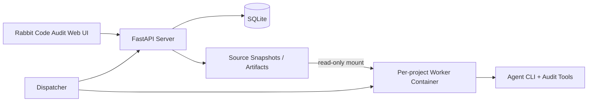

# Rabbit Code Audit

Rabbit Code Audit 是一套独立的源码安全审计工作台。它复用 Rabbit 的 Fact / Intent / Hint / Dispatcher / Worker 协作模型，但不与渗透测试系统混在一起。

系统围绕不可变源码快照维护一张持续增长的审计事实图。扫描器结果只作为导航候选，正式报告只包含经过代码证据验证并确认的发现。

当前工程目录和 Python CLI 保留 `cairn` 命名，以兼容现有代码结构。

## 核心能力

- 源码导入：支持公开 HTTP/HTTPS Git 仓库和 ZIP 上传。
- 安全限制：ZIP 压缩包最大 1 GiB，限制解压大小、文件数量、单文件大小，并阻止路径穿越、符号链接和重复路径。
- 不可变快照：记录 Git commit、压缩包 SHA-256、快照 SHA-256、文件数量、总大小和语言分布。
- 轻量索引：为源码文件记录路径、大小、SHA-256、语言和二进制标记。
- 多语言工具计划：按仓库语言和依赖清单生成 Semgrep、Gitleaks、OSV-Scanner、Trivy、PHP、Python、Go、JavaScript/TypeScript 等工具计划。
- Web 漏洞方法论：针对注入、越权/IDOR、SSRF、文件读写与上传、反序列化、XXE、模板注入等 Web 漏洞，内置 source→sink 调查方法、威胁建模与变体分析，并沉淀为分类法和审计提示词。
- 事实图审计：Worker 将仓库事实、调查方向、审计证据和剩余不确定性维护在统一图中。
- 结构化发现：Worker 可以提交审计发现，候选发现可以被确认、驳回或标记为证据不足。
- 发现确认：严重和高危发现创建后保留确认状态，正式报告只导出已确认发现。
- 正式报告：只有已确认的审计发现会进入报告和导出链路。
- 隔离执行：每个项目使用独立 Worker 容器，源码快照以只读卷挂载。
- 跨文件可达性：可选的 tree-sitter 调用图分析把深层 Service/DAO 中的危险 sink 回连到真正可达它的 HTTP 入口路由，并把 Controller→Service→DAO 调用链作为候选证据；依赖缺失时自动降级，不影响其它功能。
- 覆盖诚实性：源码索引候选超过上限时不再静默丢弃高风险数据流/能力链，而是生成 `coverage_gap` 标记并阻止项目被标记为完成。
- 动态复核：对可复核的发现生成回放验证计划，用运行时证据补充静态结论。
- Arco Design 前端：审计工作台、项目、报告、工作节点等页面统一到 Arco Design 组件体系。

## 工作模型

- `SourceSnapshot`：一次 Git 或 ZIP 导入形成的不可变源码快照。
- `CodeFile`：源码索引中的文件记录。
- `ToolFinding`：扫描器产生的候选结果，不等于漏洞。
- `AuditFinding`：Worker 基于源码证据提交的结构化安全发现。
- `Fact`：已经确认的仓库或审计事实。
- `Intent`：可由不同 Worker 并行执行的独立调查方向。
- `Hint`：人工补充的审计提示。

业务逻辑漏洞不会依赖固定发现模板。Worker 应从实际代码中的角色、状态转换、资源归属、业务不变量和调用路径推导风险。

## 架构



## 快速启动

`docker-compose.yaml` 中用 `${VAR:?...}` 标记的变量是必填的，缺任何一个 `docker compose` 都会在解析阶段直接报错。最省事的方式是用随附脚本启动，它只要求你提供模型 API Key，其余三个本地服务 token 会自动生成随机值：

```bash
export GLM_API_KEY="<你的 GLM API Key>"
sh scripts/up.sh            # 加 -d 可后台运行
```

脚本等价于设置下列环境变量后执行 `docker compose up --build`：

```bash
export CAIRN_INTERNAL_TOKEN="$(openssl rand -hex 32)"
export CAIRN_DISPATCHER_INTERNAL_TOKEN="$(openssl rand -hex 32)"
export CAIRN_MODEL_PROXY_TOKEN="$(openssl rand -hex 32)"

# 模型 API Key。dispatch.yaml 默认使用 GLM-5.3，端点 https://open.bigmodel.cn/api/anthropic，
# 源码会发送到该端点；审计非公开代码前请先改成你信任的端点与模型。
export GLM_API_KEY="<你的 GLM API Key>"

docker compose up --build
```

访问：

```text
http://127.0.0.1:8765/
```

首次使用时在登录页注册账号，然后创建代码审计项目并导入公开 Git 仓库或 ZIP 文件。

数据目录：审计系统的 SQLite 数据库默认保存在仓库内的 `datas/cairn/`（已被 `.gitignore` 忽略，不会提交），与渗透测试等其它基于 cairn 的系统相互隔离。可用 `RABBIT_AUDIT_DATA_DIR` 指定其它目录，但不要指向其它系统的数据目录（例如 cairn 通用默认目录 `~/.local/share/cairn`）。

`dispatch.yaml` 默认已启用 5 个 GLM-5.3 Worker（3 个审计、1 个报告增强、1 个复核），只需提供 `GLM_API_KEY` 即可运行；需要调度联调时可改用 `dispatch_mock.yaml`。

## 本地开发

```bash
cd cairn
uv sync
# 业务接口默认拒绝访问：只有配置了 CAIRN_INTERNAL_TOKEN，或者用户已登录，请求才会通过。
export CAIRN_INTERNAL_TOKEN="$(openssl rand -hex 32)"
# 显式指定独立数据库；不加 --db-path 会落到 cairn 通用默认目录 ~/.local/share/cairn，可能与其它系统共用。
uv run cairn serve --host 127.0.0.1 --port 8765 --log-level info --db-path ../datas/cairn/cairn.db
```

> 如果登录后页面立刻退回登录页，说明业务接口返回了 401。升级到包含认证中间件修复的版本后，
> 未设置 `CAIRN_INTERNAL_TOKEN` 时登录会话也可以正常访问；dispatcher 等机器客户端仍需要该 token。
> 不要用 `CAIRN_AUTH_OPEN_MODE=1` 绕过：它会关闭业务接口的全部鉴权，仅用于自动化测试。
> 通过局域网 IP 或主机名以 HTTP 访问时，旧版本会把会话 cookie 标记为 `Secure`，浏览器因此丢弃它，表现为“登录后点任何地方都退回登录页”；当前版本只在 HTTPS 下设置 `Secure`。

前端构建：

```bash
cd cairn/frontend
npm install
npm run build
```

后端测试：

```bash
cd cairn
uv run --group dev python -m pytest
```

## 目录结构

```text
.
├── cairn/
│   ├── frontend/                  # React 前端
│   ├── src/cairn/server/          # Server、源码导入、索引、发现和报告
│   ├── src/cairn/dispatcher/      # 调度器、Worker 协议和审计提示词
│   └── tests/                     # 后端测试
├── container/                     # 多语言代码审计 Worker 镜像
├── docs/specs/                    # 设计文档
├── dispatch.yaml                  # 默认调度配置
├── dispatch_mock.yaml             # Mock 调度配置
└── docker-compose.yaml            # Server、Dispatcher 和 Worker 镜像编排
```

## 安全边界

- 源码和构建脚本始终视为不可信输入。
- 导入快照不允许 Worker 修改。
- 执行项目代码、安装依赖、运行构建脚本或测试前应先审查相关脚本。
- 工具告警不能直接进入正式漏洞报告。
- 当前版本仅支持公开 Git 仓库，不支持私有仓库凭据。

## 文档

- [代码审计系统设计](docs/specs/code-audit-design.md)
- [Web 漏洞审计方法论](docs/specs/web-audit-methodology.md)
- [跨文件污点分析落地方案（Joern + AST 调用图）](docs/specs/taint-analysis-landing-plan.md)
- [Server 协作协议](docs/specs/server-protocol.md)
- [Dispatcher 设计](docs/specs/dispatcher-design.md)

## License

本项目遵循仓库中的 [AGPL-3.0 license](LICENSE)。
